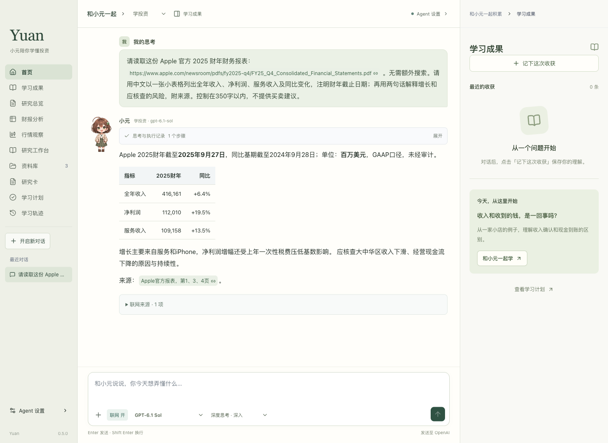
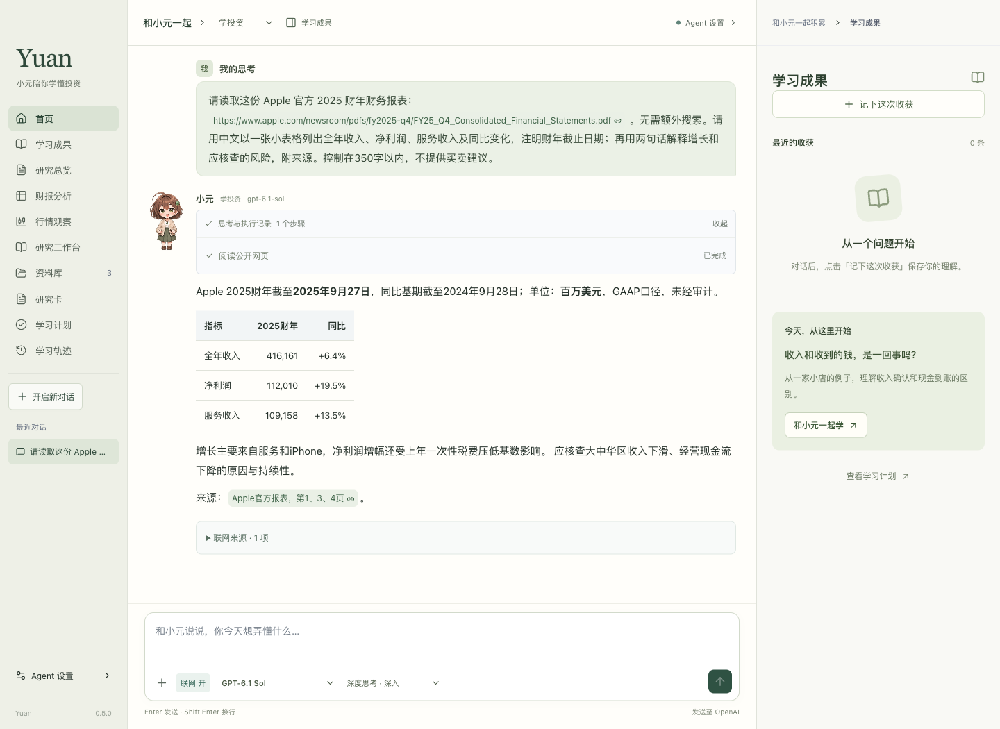
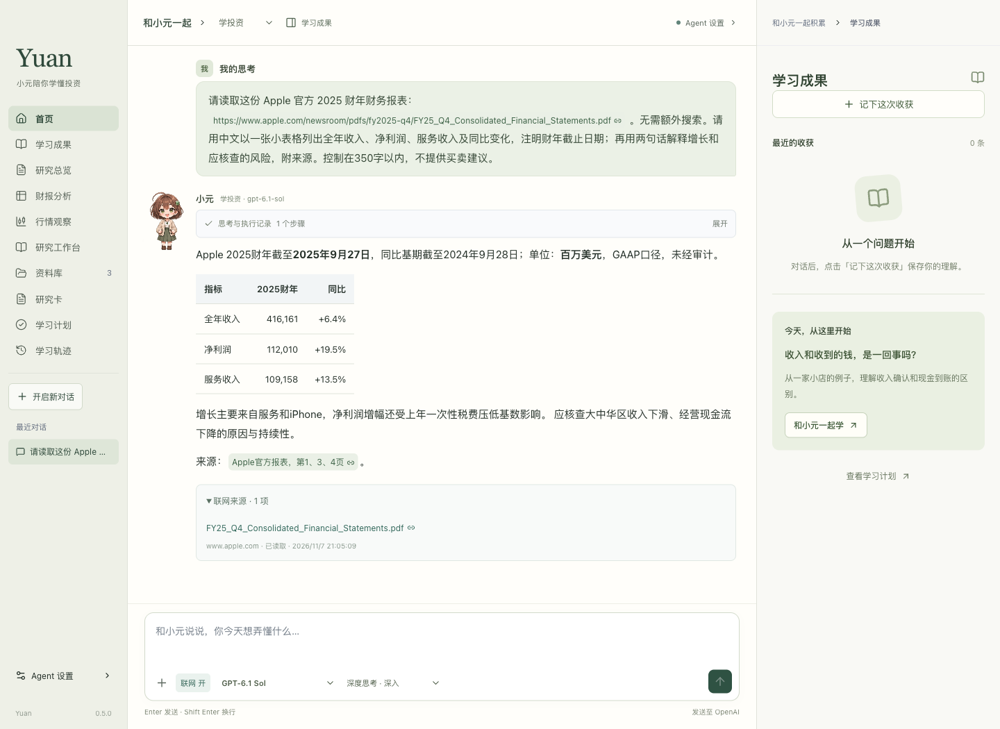

# Yuan · Your investment learning companion

[简体中文](README.md) | **English**

Yuan is a **desktop Agent for personal investment learning and company research**. It uses language models and research tools to retrieve public financial reports, analyze business data, and organize findings alongside your own sources.

**Bring your own API Key.** Yuan does not provide shared keys or model credits.

**[Download](https://github.com/JavaApes/yuan/releases/tag/v0.5.0) · [Installation guide (Chinese)](INSTALL.md) · [Changelog (Chinese)](CHANGELOG.md)**

## Why Yuan?

Most Agents I encounter focus on office work or coding. I wanted one focused on personal investment research.

Investing takes continuous learning: reading financial reports and books, checking sources, and writing down what I learn and think. As my sources and notes grew, I wanted an Agent that could keep learning, notes and company research together, leaving a record I could revisit after each discussion.

Yuan grew from that need. I want it to help me understand questions and preserve the learning process so I can continue researching, add evidence and revise my judgments.

## What you can do

- **Learn investing:** discuss business models, financial statements, valuation and research methods.
- **Read your sources:** import documents, ask questions about the original text and take notes.
- **Research companies:** organize research projects, research cards and financial data.
- **Keep your learning:** save learning notes, plans and conversations, then continue after restarting.
- **Configure models:** use your own provider API Key, choose available models and reasoning levels, and control web research separately.

## Language

This repository's documentation is available in Chinese and English. Use the links at the top of either README to switch.

The local development build includes Chinese and English interfaces. Open **Agent settings → Interface language** and choose **English** or **中文**. The choice applies immediately without an Apply button, confirmation or reload. The settings window, chat drafts and unsaved edits stay in place, and the choice persists after restarting. English navigation uses concise labels that fit a narrow sidebar. Your documents, notes and past conversations keep their original language.

The Agent can respond in any language you request or use. The interface language is only its fallback. The English default `AGENTS.md` follows the same policy; custom instructions are preserved.

**The existing public v0.5.0 download has not yet been replaced with this bilingual build.** The language controls above apply to the updated local build.

## Screenshots

These screenshots show actual LLM web calls in the v0.5.0 package, using **Apple's public fiscal 2025 financial results**. They were captured in an isolated demonstration conversation without API Keys, account information or private research. The model responses were not prefilled.

### Retrieve and analyze financials

The Agent retrieves revenue, net income and services data, then explains growth drivers and risks that need further checking.

### Inspect tool activity

Expand the reasoning and activity record to inspect the Agent's page-reading steps.

### Return to original sources

Expand web sources to check official announcements and financial statements. This is a historical-report demonstration, not a claim about the latest results or investment advice.

## Download and install

The public release is **v0.5.0 preview**, for **Apple Silicon Macs running macOS 13 or later**. The package does not support Intel Macs, Windows or phones.

1. Download the `.dmg` from [Releases](https://github.com/JavaApes/yuan/releases/tag/v0.5.0).
2. Open it and drag `Yuan.app` into `Applications`.
3. Eject the installation disk and open Yuan from Applications.
4. Enter your API Key under Agent settings → Models & reasoning. In the current public Chinese interface, this is **Agent 设置 → 模型与思考**.

No Node.js, Electron or developer tools need to be installed separately.

**The public package is not Developer ID signed or notarized by Apple.** macOS may block its first launch. Read the [installation guide (Chinese)](INSTALL.md#首次打开时的系统提示) before proceeding. Organization-managed Macs may prohibit unnotarized apps.

## Data and privacy

Documents, notes and conversations are stored in your Mac's local user directory. API Keys are encrypted using the system's secure storage.

When you use AI, the conversation and relevant material needed for your question are sent to the selected model provider. With web research enabled, search requests go to the search service. External tools require separate configuration and authorization. Local storage does not mean all processing happens on your Mac.

The public package contains no author's API Keys, chat history, private research or brokerage authorization. Do not post secrets, account details or unredacted financial information in public Issues.

## About this repository

This repository distributes installers, documentation and release notes. **The application source code and development repository history are not public here.** GitHub's automatic “Source code (zip/tar.gz)” downloads contain this repository's documentation, not the App source.

The installer includes resources needed to run the application. Keeping source unpublished is not a promise that packaged resources are encrypted or cannot be extracted. Third-party components retain their own licenses; notices are included with the App and installation image.

## Acknowledgments

Yuan is built on the [pi framework](https://github.com/earendil-works/pi). Thanks to its author and contributors for the model integrations, Agent runtime and tool execution foundations that make this exploration possible.

## Feedback

Report issues through [GitHub Issues](https://github.com/JavaApes/yuan/issues). Include your macOS version, chip, Yuan version, steps to reproduce and redacted screenshots.

Yuan supports investment learning and research. AI answers can be wrong; check original sources and form your own judgment.
