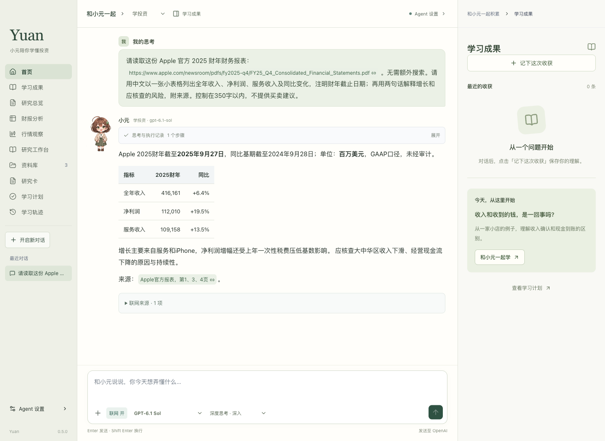
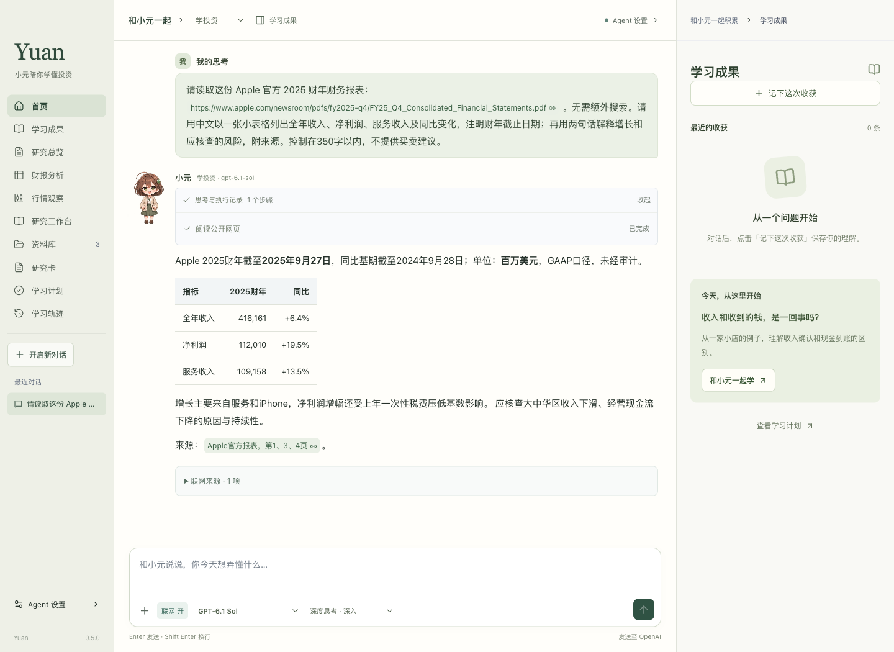
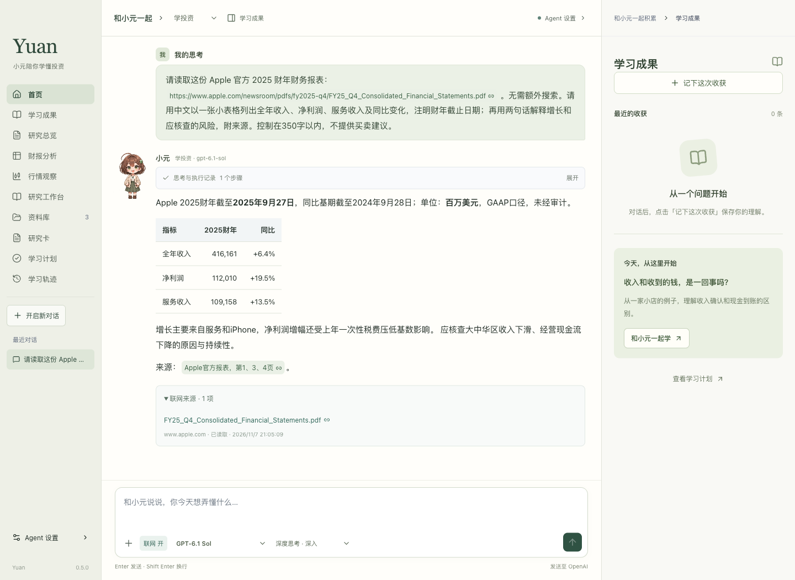

# Yuan · 小元陪你学懂投资

## v0.5.2 · 2026-11-12

第二次公开预览版已发布。新增首页研究动态、阅读笔记、长期记忆和定时任务等功能。仅发布文档与安装包，不使用 Developer ID 证书，不做 Apple 公证。

[版本说明与下载](https://github.com/JavaApes/yuan/releases/tag/v0.5.2)

**简体中文** | [English](README.en.md)

Yuan 是面向个人投资学习与公司研究的 **终端 Agent**。通过对话调用 LLM 和研究工具，获取公开财报、分析公司经营数据，并结合自己的资料整理研究成果。

**使用前需要自备 API Key。** Yuan 不提供共享密钥或模型额度

**[下载安装包](https://github.com/JavaApes/yuan/releases/tag/v0.5.2) · [安装与使用](INSTALL.md) · [版本记录](CHANGELOG.md)**

## 为什么做 Yuan？

我平时接触到的 Agent，大多面向办公或写代码，专注个人投资研究的相对少一些。这是我想做 Yuan 的起点。

投资很复杂，我自己也需要不断学习：读财报、看书、查资料，再把学到的知识和自己的思考记下来。随着资料和笔记越来越多，我希望有一个 Agent，能把学习、笔记和公司研究放在一起管理，让每次阅读和讨论都留下可以回看的积累。

Yuan 就是从这个需求出发做的。我希望它能陪我把问题弄懂，也把学习的过程保存下来，方便以后继续研究、补充和修正自己的判断。

## 可以做什么

- **投资学习**：围绕商业模式、财报、估值与研究方法展开对话。
- **资料阅读**：导入自己的资料，结合原文提问、记录笔记。
- **公司研究**：整理研究项目、研究卡与财务数据。
- **学习积累**：保存学习成果、计划和对话，重启后继续。
- **模型配置**：使用自己的模型服务 API Key，管理可用模型与思考强度；联网研究可单独控制。

## 语言

本仓库说明支持中英文，点击页面顶部的 **English / 简体中文** 切换。

v0.5.2 已加入中英文界面：在 **Agent 设置 → 界面语言 / Language** 选择中文或 English 即刻生效，无需应用按钮、确认或重新载入。设置窗口、聊天草稿及未保存编辑保留，重启后沿用所选语言。英文导航采用简洁名称，适配窄侧栏。已有资料、笔记和对话保留原语言。

Agent 跟随用户请求或使用的语言交流，不限制语言；界面语言仅作偏好不明确时的默认值。英文默认 `AGENTS.md` 使用同一规则，已有自定义指令保留。

**v0.5.2 公开预览版已包含上述中英文界面。**

## 使用截图

以下为 v0.5.0 安装包中的真实 LLM 联网调用，演示任务是获取并分析 **Apple 2025 财年公开财报**。截图使用独立演示会话，不展示 API Key、账户信息或私人研究资料；模型回答并非预填示例。

### 获取财报并分析

向 Agent 提问后，模型整理收入、净利润和服务业务数据，并解释增长来源及需要继续核查的风险。

### 查看执行过程

展开思考与执行记录，查看 Agent 调用网页读取工具的实际步骤。

### 回到原始来源

展开联网来源，继续核对官方公告与财务报表。截图为特定历史报告的演示，不代表最新财报或投资建议。

## 下载与安装

当前版本为 **v0.5.2 预览版**，支持 **Apple Silicon（M 系列）Mac，macOS 13 或更新版本**。当前安装包不支持 Intel Mac、Windows 或手机。

1. 在 [Releases](https://github.com/JavaApes/yuan/releases/tag/v0.5.2) 下载 `.dmg` 文件。
2. 打开 DMG，将 `Yuan.app` 拖入 `Applications`。
3. 弹出安装磁盘，从“应用程序”打开 Yuan。
4. 在 **Agent 设置 → 模型与思考** 中填写自己的 API Key。

无需安装 Node.js、Electron 或开发工具。

**当前公开安装包尚未经过 Apple Developer ID 正式签名及公证。** 首次打开可能被 macOS 拦截，请先阅读 [安装说明](INSTALL.md#首次打开时的系统提示)。受组织管理的 Mac 可能不允许安装未公证应用。

## 数据与隐私

资料、笔记、会话等保存在当前 Mac 的本地用户目录。API Key 通过系统安全存储加密保存。

使用 AI 时，提问所需的对话与相关资料会发送给所选模型服务；开启联网研究后，检索请求会发送给联网服务。连接外部工具需要单独配置和授权。因此，“本地保存”不代表“所有处理都在本机”。

公开安装包不包含作者的 API Key、聊天记录、研究资料或证券账户授权。请勿在公开 Issues 中粘贴密钥、账户资料或未脱敏的财务信息。

## 关于这个仓库

这里用于发布安装包、使用说明和版本记录。**目前不公开项目源代码，也不包含开发仓库的提交历史。** GitHub 自动提供的 “Source code (zip/tar.gz)” 只包含本仓库文档，不是 App 源码。

安装包包含应用运行所需的程序资源；未公开源码不等于对安装包内容作加密或防提取承诺。第三方组件仍适用各自的许可，相关声明随应用和安装镜像提供。

## 致谢

Yuan 基于 [pi 框架](https://github.com/earendil-works/pi) 开发。非常感谢 pi 的作者和所有贡献者，提供了模型接入、Agent 运行与工具调用的基础，让我能够在此之上探索投资学习和研究的使用方式。

## 反馈

欢迎通过 [Issues](https://github.com/JavaApes/yuan/issues) 反馈问题。请说明 macOS 版本、芯片型号、Yuan 版本、复现步骤，并提供脱敏截图。

Yuan 用于投资学习和研究辅助。AI 回答可能出错，请核对原始来源并独立判断。
